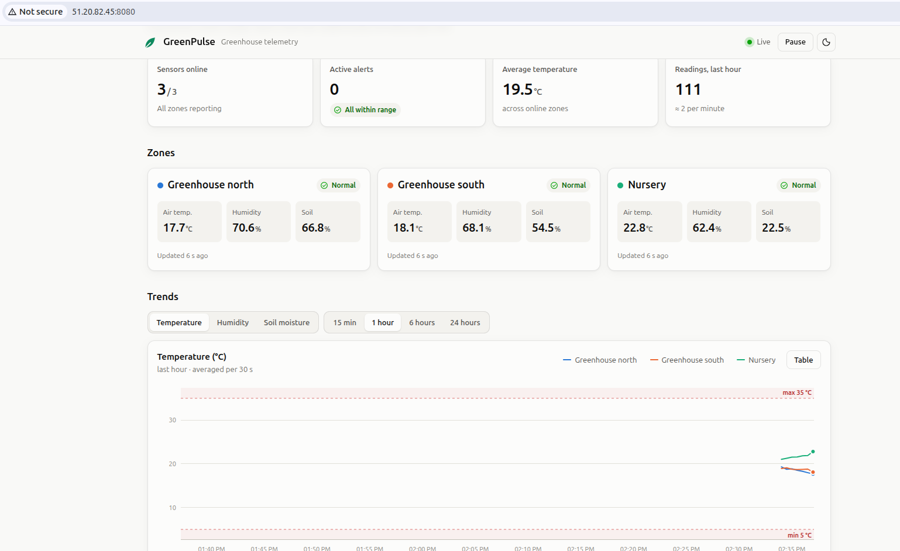
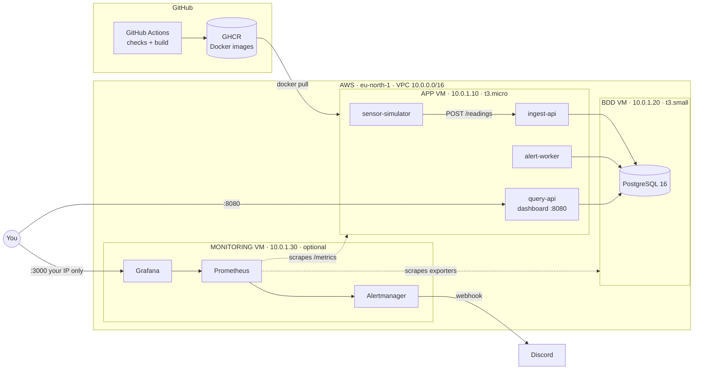
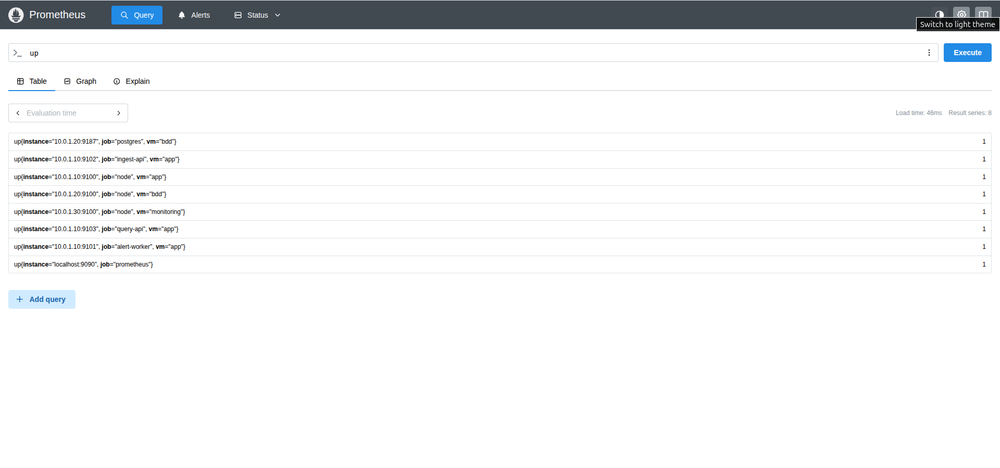
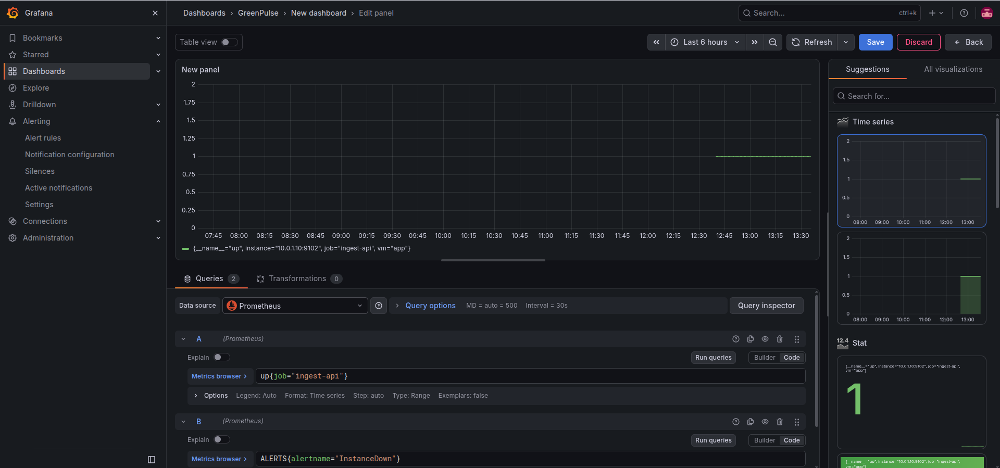
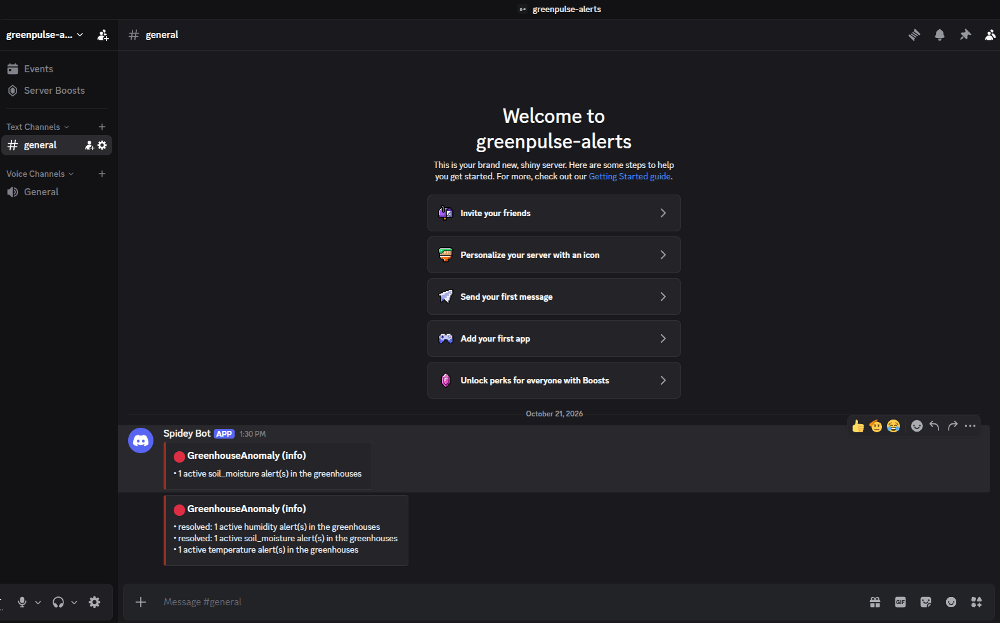

# GreenPulse

**A greenhouse telemetry platform, deployed on AWS with one `terraform apply`.**

Virtual sensors send temperature, humidity and soil-moisture readings. The platform stores them, detects anomalies, shows them on a live dashboard and alerts on Discord when something goes wrong, with the platform itself or with a greenhouse.

[](https://github.com/SEMGOODD/GreenPulse/actions/workflows/ci.yml)


*The dashboard served by query-api on port 8080, deployed on AWS.*

| Area | Tools |
|---|---|
| Infrastructure as code | Terraform (modules, S3 remote state with locking) |
| Configuration management | Ansible (roles, Vault, inventory generated by Terraform) |
| Application | 4 Python microservices (FastAPI), PostgreSQL 16 |
| Containers | Docker, Docker Compose, images published to GHCR |
| CI/CD | GitHub Actions |
| Monitoring and alerting | Prometheus, Grafana, Alertmanager, node_exporter, postgres_exporter, Discord |
| Cloud | AWS (VPC, EC2, security groups, S3) |

The project started from a school assignment (*TP Noté ICC 2026*: two VMs, Terraform modules, Ansible roles, a FastAPI app saying "hello NAME"), then grew into a small production-like platform. [How it covers the assignment](#assignment-requirements).

---

## Architecture



### The 4 microservices

| Service | Role | Exposed |
|---|---|---|
| **sensor-simulator** | 3 virtual zones, one reading every 5 s, day/night cycle, random incidents (heatwave, cold snap, dry air, irrigation failure) | nothing |
| **ingest-api** | `POST /readings`: validates (Pydantic) and stores readings | Docker network only |
| **alert-worker** | Compares new readings to thresholds, opens, updates and resolves alerts (one active alert per sensor and metric, enforced by the database) | nothing |
| **query-api** | Dashboard (`/`) and read-only JSON API (`/api/...`), keeps the assignment's `hello NAME` | **port 8080** |

Each service exposes Prometheus metrics on its own port (9101 to 9103), never on the public port 8080.

### Repository layout

```
greenpulse/
├── terraform/
│   ├── bootstrap/            # S3 bucket for the remote state (run once)
│   ├── modules/
│   │   ├── network/          # VPC, subnet, internet gateway, security groups
│   │   ├── app/  bdd/        # one EC2 instance each
│   │   └── monitoring/       # optional EC2 instance (enable_monitoring)
│   ├── ansible.tf            # generates the inventory, runs ansible-playbook
│   └── main.tf variables.tf outputs.tf versions.tf
├── ansible/
│   ├── roles/
│   │   ├── common/           # updates, SSH hardening, automatic security updates
│   │   ├── postgres/         # PostgreSQL, users, pg_hba, SQL scripts
│   │   ├── docker/           # Docker Engine + Compose plugin
│   │   ├── app/              # deploys the microservices with Compose
│   │   ├── node_exporter/    # system metrics, every VM
│   │   ├── postgres_exporter/
│   │   └── monitoring/       # Prometheus, Alertmanager, Grafana (+ alert rules and their tests)
│   ├── group_vars/all/       # shared variables + vault.yml (encrypted secrets)
│   └── playbook.yml
├── services/
│   ├── ingest-api/  alert-worker/  query-api/  sensor-simulator/
│   ├── db/schema.sql         # telemetry tables, shared by Ansible and the dev stack
│   ├── docker-compose.yml    # production stack
│   └── docker-compose.dev.yml  # + a local PostgreSQL, for development
├── images/                   # screenshots used in this README
└── .github/workflows/ci.yml
```

---

## Run it locally (no AWS)

Requirements: Docker with the Compose plugin.

```bash
cd services
cp .env.example .env
docker compose -f docker-compose.yml -f docker-compose.dev.yml up --build
```

Open <http://localhost:8080> (change `APP_PORT` in `.env` if the port is taken). Stop with `docker compose -f docker-compose.yml -f docker-compose.dev.yml down` (add `-v` to delete the data).

---

## Deploy on AWS

### Prerequisites

| Tool | Version used |
|---|---|
| Terraform | 1.16 (requires ≥ 1.10) |
| Ansible | ansible-core 2.21 |
| AWS CLI | v2, with a profile named `greenpulse` |
| SSH key | `~/.ssh/id_ed25519` (configurable) |

```bash
cd ansible && ansible-galaxy collection install -r requirements.yml
```

### 1. Secrets (once)

The secrets live in `ansible/group_vars/all/vault.yml`, encrypted with Ansible Vault. The vault password is read from `~/.greenpulse_vault_pass`, **outside the repository**. To start with your own secrets:

```bash
openssl rand -base64 32 > ~/.greenpulse_vault_pass && chmod 600 ~/.greenpulse_vault_pass
cd ansible
ansible-vault create group_vars/all/vault.yml
```

| Variable | Used for |
|---|---|
| `vault_db_password` | PostgreSQL user of the application |
| `vault_grafana_admin_password` | Grafana `admin` account |
| `vault_discord_webhook_url` | optional: Discord notifications |

### 2. Remote state (once)

```bash
cd terraform/bootstrap
terraform init && terraform apply
```

This creates a versioned, encrypted S3 bucket and writes `terraform/backend.hcl`.

### 3. Deploy

```bash
cd terraform
cp terraform.tfvars.example terraform.tfvars   # set allowed_ssh_cidr to your IP (/32)
terraform init -backend-config=backend.hcl
terraform apply                                 # add -var enable_monitoring=true for monitoring
```

One `apply` creates the network and the VMs (BDD before APP), generates `ansible/inventory.ini`, runs the playbook (it waits for SSH and cloud-init first), then calls the API and prints the answer. Useful outputs:

```bash
terraform output app_url          # the dashboard
terraform output ssh_commands     # ready-to-paste SSH commands
terraform output grafana_url      # when enable_monitoring = true
```

### 4. Destroy

```bash
terraform destroy                 # same -var enable_monitoring=... as for apply
```

The S3 state bucket is not part of this stack and stays (its cost is negligible).

**Cost**: about 5 cents per hour for the 2 VMs, 8 cents with monitoring (instances, public IPv4 addresses and disks). Nothing is meant to run permanently: deploy, test, destroy.

---

## CI/CD

[`.github/workflows/ci.yml`](.github/workflows/ci.yml), on every pull request and every push to `main`:

| Job | Checks |
|---|---|
| Terraform checks | `terraform fmt -check`, `init -backend=false`, `validate` (main config and bootstrap) |
| Ansible checks | `ansible-lint` (production profile) |
| Docker images | builds the 4 images |
| Publish (×4, `main` only) | runs only if the 3 checks pass, then pushes each image to GHCR |

Images: `ghcr.io/semgoodd/greenpulse-<service>`, tagged `latest` and `sha-<commit>`. The APP VM **pulls** these tested images instead of building on the VM. To roll back to an earlier version without rebuilding:

```bash
terraform output ansible_rerun_command      # cd ... && ansible-playbook playbook.yml
# append: -e app_image_tag=sha-<commit>
```

`app_build_images: true` (Ansible variable) makes the VM build the images itself, as a fallback.

---

## Monitoring and alerting

Enabled with `enable_monitoring = true`: a third VM runs Prometheus, Alertmanager and Grafana (Docker Compose). The web UIs are reachable from `allowed_ssh_cidr` only; the metrics ports only from the monitoring VM.

| Scraped target | Port | Metrics |
|---|---|---|
| node_exporter (3 VMs) | 9100 | CPU, memory, disk, network |
| postgres_exporter (BDD) | 9187 | connections, transactions, database size |
| alert-worker | 9101 | readings processed, alerts opened/resolved/active, backlog, batch duration |
| ingest-api | 9102 | HTTP requests and latency, readings per sensor, last reading per sensor |
| query-api | 9103 | HTTP requests and latency |


*Prometheus on the monitoring VM: `up` returns 1 for each of the 8 targets.*


*Grafana, with Prometheus as its provisioned datasource: the queries used to watch an outage test (`up{job="ingest-api"}` and `ALERTS{alertname="InstanceDown"}`).*

**Alert rules** ([`rules/greenpulse.yml`](ansible/roles/monitoring/files/rules/greenpulse.yml)):

| Alert | Fires when | Severity |
|---|---|---|
| InstanceDown | a target does not answer for 1 min | critical |
| PostgresDown | the database is unreachable | critical |
| WorkerStalled | alert-worker processed nothing for > 2 min | critical |
| HighErrorRate | > 5 % of HTTP answers are 5xx, for 5 min | critical |
| SensorSilent | a zone sent nothing for > 2 min | warning |
| WorkerBacklogGrowing | > 100 readings waiting, for 5 min | warning |
| ApiSlow | p95 latency > 1 s, for 5 min | warning |
| DiskAlmostFull | < 15 % free disk, for 10 min | warning |
| MemoryHigh | > 90 % memory used, for 10 min | warning |
| GreenhouseAnomaly | a greenhouse value is out of its normal range | info |

The rules have unit tests (fake time series in, expected alerts out):

```bash
cd ansible/roles/monitoring
docker run --rm -v "$PWD:/w" -w /w/tests --entrypoint promtool prom/prometheus:v3.15.0 test rules rules_test.yml
```

Alertmanager groups related alerts in one message, sends a "resolved" message when it is fixed, and mutes the warnings of a VM that is entirely down.


*Business alerts on Discord: greenhouse anomalies detected by alert-worker, grouped in one message, with their resolution.*

---

## Security choices

- **SSH** only from one IP (`allowed_ssh_cidr`), keys only, no root login. Only the public key is uploaded to AWS.
- **PostgreSQL** is reachable only from the APP security group, listens only on localhost and its private IP, and `pg_hba.conf` allows only the APP VM's address, with `scram-sha-256`.
- **Secrets** are encrypted with Ansible Vault and never printed in Ansible's output (`no_log`). `.tfvars`, state files, `.env` files and the vault password are gitignored.
- **Containers** run as a non-root user, with memory limits and log rotation.
- **Metrics** are on separate ports, bound to the private IP and open only to the monitoring security group. The postgres_exporter connects without a password (peer authentication) and only has the read-only `pg_monitor` role.
- **CI** uses a read-only token by default; only the publish job may write packages.
- **EC2**: instance metadata v2 enforced, encrypted disks.

---

## Design decisions and trade-offs

| Decision | Why |
|---|---|
| Both VMs in a **public subnet** | A private subnet needs a NAT gateway (about $35/month, more than the rest of the project). Compensated by strict security groups and PostgreSQL listening on the private IP only. |
| Region **eu-north-1** | The AWS account (AWS "Projects" experience) has an AWS-managed service control policy that only allows this region. |
| **No `terraform plan` in CI** | Planned with OIDC (GitHub assumes a read-only IAM role, no stored keys). The same account policies forbid IAM OIDC providers, so `plan` runs locally. |
| Security groups in the **network** module | The DB group references the APP group, and the BDD VM must be created first: keeping both groups in one module avoids a dependency cycle. |
| `terraform_data` + `local-exec` to run Ansible | Built into Terraform. It re-runs the playbook when a VM, the inventory, the Ansible code or the application code changes. |
| Separate **bootstrap** stack | The bucket cannot store the state of the code that creates it. |
| Images built by CI, **pulled** by the VM | The deployed image is the tested one; deploying is faster on the small VM; any `sha-` tag can be redeployed. |
| Monitoring VM **optional** | It only costs money while it is useful. |

---

## Assignment requirements

How the platform covers *TP Noté ICC 2026*. The first version, which follows the assignment literally (FastAPI in a Python virtualenv, run by its own systemd service), is commit [`c7cb57f`](https://github.com/SEMGOODD/GreenPulse/tree/c7cb57f).

| Requirement | Where |
|---|---|
| `app` and `bdd` Terraform modules, every parameter in variables | `terraform/modules/`, `terraform/variables.tf` |
| BDD VM created before APP VM | `depends_on = [module.bdd]` in `terraform/main.tf` |
| APP: 1024 MB, BDD: 2048 MB, 20 GB, Ubuntu, IP1 / IP2 | `t3.micro` (1 GiB) / `t3.small` (2 GiB), 20 GB gp3, Ubuntu 24.04, `10.0.1.10` / `10.0.1.20`. AWS sets RAM through the instance type, and both types have 2 vCPUs. |
| Outputs needed by Ansible | `terraform output` (IPs, SSH user, key, commands) |
| PostgreSQL role: packages, group, user in the group, database owned by the user | `ansible/roles/postgres` |
| Connections only from the APP VM and localhost | `pg_hba.conf` + `listen_addresses` + security group |
| SQL script: table named like the user, auto-increment `id`, `name` | `roles/postgres/templates/init.sql.j2` |
| Application reading `name` from PostgreSQL, started by a system service | `services/query-api` (Docker containers, restarted by the Docker daemon) |
| API request registered and shown in an Ansible `debug` | end of `ansible/roles/app/tasks/main.yml` |
| No `shell`, `command` or `raw` | none in the playbook |
| Inventory generated with `local_file`, `ansible-playbook` launched by Terraform | `terraform/ansible.tf` |
| Only `terraform apply`, then `http://IP_APP:8080` shows `hello NAME` | the dashboard heading |
